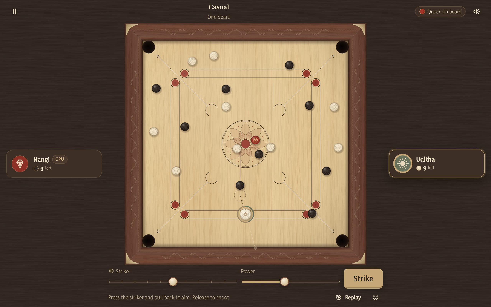
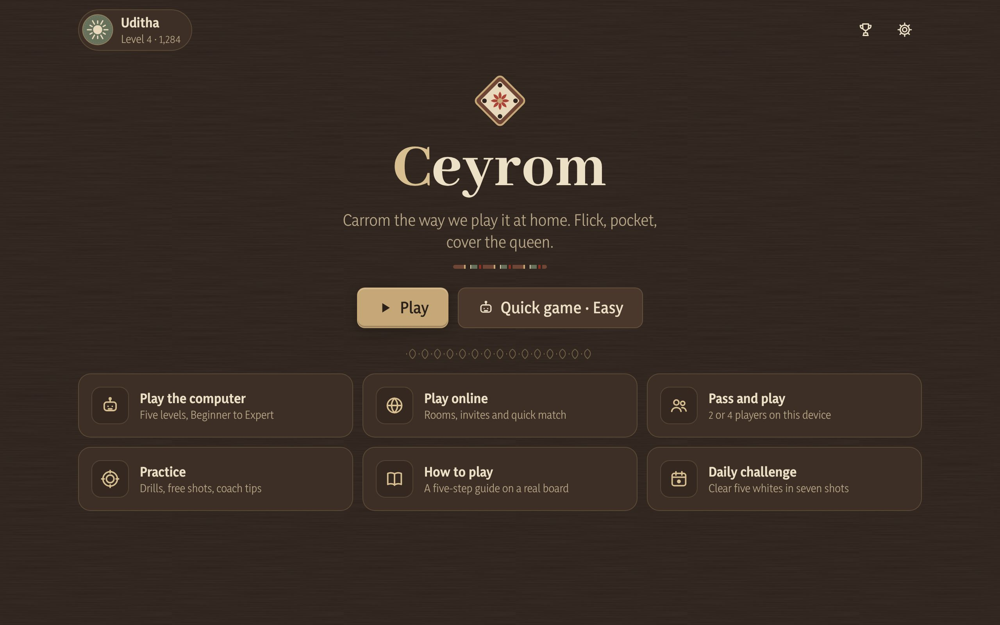
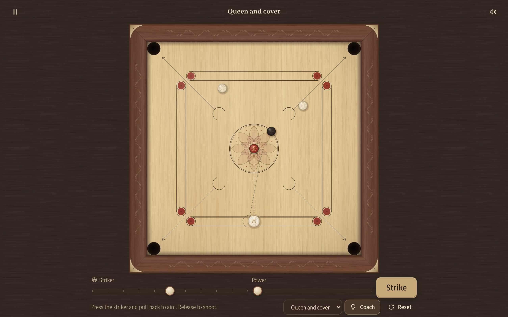
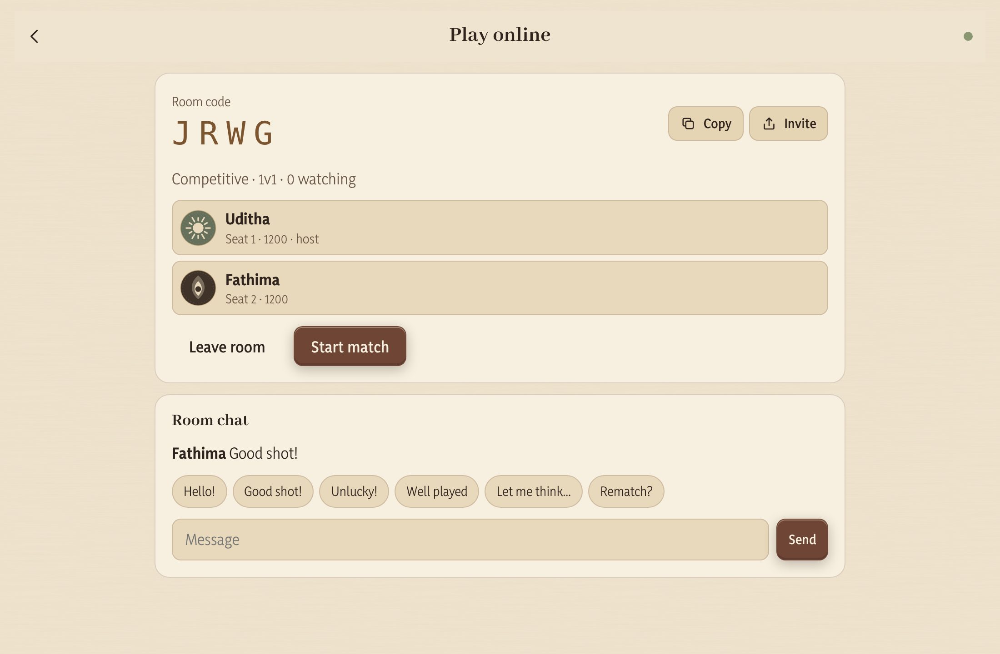
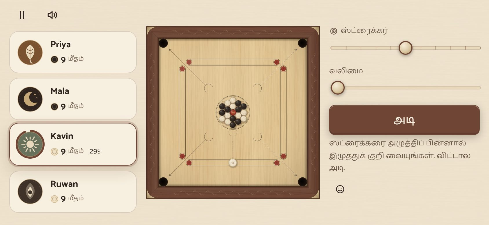
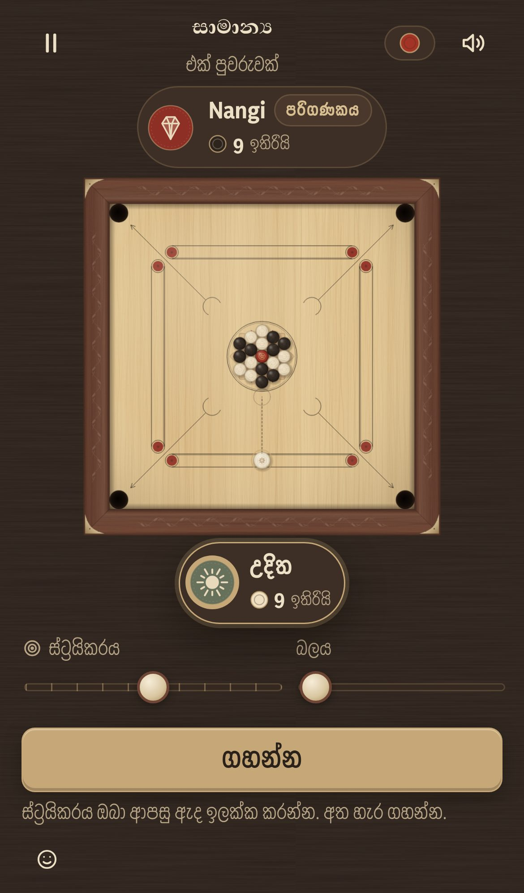

<div align="center">

# Ceyrom

**Sri Lankan carrom in your browser.**<br>
Flick the striker, pocket your coins, cover the queen: against the computer, with family on one screen, or with anyone online.

[](https://github.com/uditha1994/ceyrom/actions/workflows/ci.yml)
[](LICENSE)




</div>

---

## Contents

- [Features](#features)
- [Screenshots](#screenshots)
- [Quick start](#quick-start)
- [How to play](#how-to-play)
- [Controls](#controls)
- [Project structure](#project-structure)
- [How it works](#how-it-works)
- [Deployment](#deployment)
- [Scripts](#scripts)
- [Roadmap](#roadmap)
- [Contributing](#contributing)
- [License](#license)

## Features

| | |
| --- | --- |
| **Real physics** | Made for carrom: a 74 cm ICF board, coin-to-coin and cushion collisions, friction, spin and pockets. The same shot gives exactly the same result on every device. |
| **Proper rules** | Queen and cover, striker fouls, penalty coins (dues), last-coin rules and board scoring. Presets: Competitive (first to 25), Casual, Gedara (home rules) and Freestyle (20/10/50), plus custom rules for private rooms. |
| **Computer opponent** | Five levels from Beginner to Expert. Higher levels aim more accurately, try rebound shots and go after the queen. The computer never bends the physics. |
| **Play together** | Pass-and-play for 2 or 4 players, and the board turns to face whoever is shooting. Online: private rooms with a 4-letter code, invite links, quick match (1v1 and 2v2), spectators and rematches. |
| **Fair online play** | The server checks and simulates every shot, so results can't be faked. Dropped players reconnect without losing the game. Elo ratings and leaderboards: global, Sri Lanka, weekly, monthly and friends. |
| **Learn and practise** | A five-step tutorial on a real board, practice drills with a coach that suggests a shot, instant replay, and a daily challenge that's the same for everyone. |
| **Three languages** | English, Sinhala (සිංහල) and Tamil (தமிழ்) throughout, with fonts chosen for each script and local number and date formats. Quick-chat phrases appear in each reader's own language. |
| **Sri Lankan look** | Wood-grain boards, a lotus (pala peththa) centre, carved vine (liyawela) on the frame and brass corner plates. Board collection: Gedara Jak, Kandy Ebony, Galle Teak, Kitul Night. Strikers: ivory, brass, lacquer and moonstone. |
| **Everywhere** | Phone, tablet and desktop, portrait and landscape. Touch, mouse and keyboard. Light and dark themes, reduced motion, battery saver and low-data mode. The computer, pass-and-play and practice modes work offline. |

## Screenshots

<table>
  <tr>
    <td width="50%"><br><sub>Main menu</sub></td>
    <td width="50%"><br><sub>Practice with the coach's suggested line</sub></td>
  </tr>
  <tr>
    <td><br><sub>Private online room with invite code and quick chat</sub></td>
    <td><br><sub>Four players on one phone, in Tamil</sub></td>
  </tr>
</table>

<p align="center"><br><sub>Phone layout in Sinhala</sub></p>

## Quick start

You need [Node.js](https://nodejs.org/) 20 or newer.

```bash
git clone https://github.com/uditha1994/ceyrom.git
cd ceyrom
npm install
```

To play against the computer, with friends on one device, or in practice mode, start the client:

```bash
npm run dev
```

Open http://localhost:5173.

Online play also needs the game server. Run it in a second terminal:

```bash
npm run dev:server
```

The dev client forwards `/ws` and `/api` to the server on port 8787. Open two browser windows to play yourself online.

## How to play

1. Each side has **9 coins**: white or black. The player who breaks plays white.
2. Place the striker on your **baseline**, aim forward, and shoot.
3. Pocket one of **your own coins** and you shoot again.
4. Pocket the red **queen**, then **cover** her by pocketing one of your coins on the same or the next shot. Miss the cover and she goes back to the centre.
5. Pocketing the **striker** is a foul: one of your pocketed coins returns to the centre and your turn ends.
6. You can't pocket your last coin before the queen is covered.
7. The board winner scores **1 point for each opponent coin left**, plus **3 for the queen** if they covered it. Competitive games go to 25.

The tutorial in the app (**How to play** on the main menu) walks through this on a real board.

## Controls

| Action | Touch / mouse | Keyboard |
| --- | --- | --- |
| Move striker | Slide the striker sideways, drag along your baseline, or use the Striker slider | <kbd>←</kbd> <kbd>→</kbd> (tap to nudge, hold to glide) |
| Aim | Press the striker and pull back (slingshot), or tap where to aim | <kbd>A</kbd> <kbd>D</kbd> |
| Power | How far you pull back, or the Power slider | <kbd>↑</kbd> <kbd>↓</kbd> |
| Shoot | Release, or press **Strike** | <kbd>Space</kbd> |
| Cancel a shot | Drag back onto the striker (dashed ring) and release | <kbd>↓</kbd> to 0% |
| Fine adjustment | — | Hold <kbd>Shift</kbd> |
| Pause | Pause button | <kbd>Esc</kbd> |

**Tips**
- The striker slides around any coin sitting on your baseline, so wherever it rests is a legal spot.
- The power ring around the striker fills olive, then brass, then red. Ticks mark 25, 50 and 75%, and the exact percentage shows beside the striker. You hear a soft click (and feel a light buzz on phones) at every 10%.

In Settings you can switch between **Pull back** and **Point and strike** aiming, and set the aim guide to Full, Short or Off. Point and strike remembers your last power.

## Project structure

```
ceyrom/
├── src/
│   ├── core/          # pure TypeScript, no DOM, shared by browser and server
│   │   ├── physics.ts   deterministic carrom physics
│   │   ├── rules.ts     rule engine: turns, fouls, queen, scoring
│   │   ├── ai.ts        computer opponent
│   │   └── protocol.ts  WebSocket message types
│   ├── game/          # browser game layer
│   │   ├── controller.ts  game loop, input, AI turns, online sync
│   │   ├── renderer.ts    canvas drawing and effects
│   │   ├── textures.ts    procedural board and coins
│   │   └── audio.ts       synthesised sound and music
│   ├── net/           # reconnecting WebSocket client
│   ├── store/         # Zustand stores (settings, profile, HUD)
│   ├── i18n/          # i18next setup
│   └── ui/            # React screens and components
├── locales/           # en / si / ta translation files
├── server/            # Node authoritative game server
├── tests/             # Vitest suites
└── docs/screenshots/
```

## How it works

**Physics.** Distances are in millimetres on a real 74 cm board (coin Ø 31 mm, 5.5 g; striker Ø 41 mm, 15 g; pocket Ø 44.5 mm). The simulation runs in fixed 1/240 s steps, separate from the frame rate, and the renderer smooths the motion between steps. Fast pieces are moved at most 3 mm at a time, so they can never pass through each other or through a cushion. The physics code uses only basic arithmetic and square roots, which give exactly the same answer on every device. So a shot plays out identically in Chrome, Safari, Firefox and on the server, and the tests check this.

**Rules.** `src/core/rules.ts` is data in, data out, with no timers or DOM. The browser, the AI and the server all run exactly the same rules, and new modes are just new rule settings.

**Computer opponent.** For every coin and pocket the AI works out where the striker must hit, and checks that the path is clear. At Hard and Expert it also considers rebound shots. It tries its best few ideas with the same physics, scores each result (coins pocketed, fouls, the queen, what it leaves for the opponent), then plays the winner with a hand as steady as its level.

**Online.** A player sends only the shot: striker position, direction, power and a sequence number. Before accepting it, the server checks:

- whose turn it is
- that the striker placement is legal and the shot goes forward
- that the values are in range
- that the sequence number is new, so a duplicate or replayed shot is ignored

The server then simulates the shot, applies the rules, and sends everyone the shot and the resulting board. The shooter's screen starts moving straight away, and everyone else replays the same shot. When the pieces stop, every screen snaps to the server's result. Because the physics is identical everywhere, that snap is invisible.

## Deployment

```bash
npm run build                        # client → dist/, server → dist-server/server.mjs
CEYROM_SECRET=$(openssl rand -hex 32) npm start
```

One Node process serves the game, the API and the WebSocket on the same port.

| Variable | Default | Purpose |
| --- | --- | --- |
| `PORT` | `8787` | HTTP and WebSocket port |
| `CEYROM_SECRET` | generated | Key that signs player tokens; kept in `CEYROM_DATA/secret.key` if unset |
| `CEYROM_DATA` | `./data` | Where player and match data is saved |
| `CEYROM_ORIGINS` | any | Allowed browser origins (comma-separated) when the client is hosted elsewhere |
| `VITE_SERVER_URL` | same origin | Set at build time when the client and server are on different domains |

Health check: `GET /api/health`. Leaderboard: `GET /api/leaderboard?scope=global|lk|weekly|monthly|friends`.

For an **offline single file**, run `npm run build:single`. It writes `dist-single/index.html`, which you can open straight from disk or host anywhere. CI also attaches this file to every run as the `ceyrom-offline` artifact.

## Scripts

| Command | What it does |
| --- | --- |
| `npm run dev` | Client dev server with hot reload |
| `npm run dev:server` | Game server, restarts on change |
| `npm test` | Vitest: physics, rules, AI and server tests |
| `npm run typecheck` | TypeScript strict check |
| `npm run build` | Production client and server bundle |
| `npm run build:single` | Self-contained offline `index.html` |
| `npm start` | Run the built server |

## Roadmap

- [ ] PostgreSQL storage, replacing the JSON file (`server/store.ts` already sits behind a `Store` interface)
- [ ] Google / Facebook login, replacing the current guest accounts
- [ ] Village Tournament and Ceylon Championship modes
- [ ] Friend list and direct challenges
- [ ] Shot-of-the-match replay on the results screen
- [ ] Native-speaker review of the Sinhala and Tamil text
- [ ] Bundled fonts for fully offline typography

## Contributing

Contributions are welcome. Read [CONTRIBUTING.md](CONTRIBUTING.md) for the branch model (`main` ← `develop` ← `feature/*`), commit style (Conventional Commits) and pre-PR checks. Report bugs and ideas through [GitHub Issues](https://github.com/uditha1994/ceyrom/issues).

## License

[MIT](LICENSE). See [CHANGELOG.md](CHANGELOG.md) for release notes.
